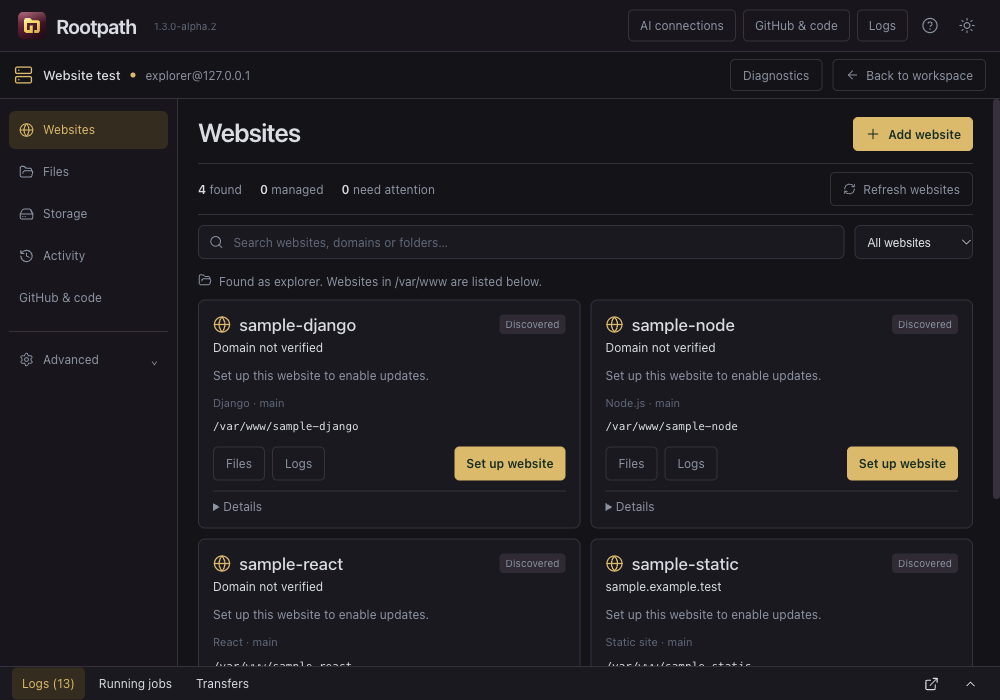

<p align="center">

</p>

# Rootpath: an open-source SSH and SFTP client for Mac and Windows

**Browse your VPS like a file manager. Review website deployments before they run.**

I wanted to manage my VPS through folders and buttons, without turning every file change into a terminal session. That's why I started Rootpath.

You connect with your server's IP address, username and password or SSH key. From there, you can browse files, edit a configuration, check storage, follow logs and work through a website deployment. There's a terminal when you need one, but you don't have to start there.

<p>
<a href="https://github.com/afnanplk/rootpath/releases/download/v1.3.0-alpha.2/Rootpath-1.3.0-alpha.2-mac-arm64.dmg"></a>
<a href="https://github.com/afnanplk/rootpath/releases/download/v1.3.0-alpha.2/Rootpath-1.3.0-alpha.2-win-x64.exe"></a>
</p>

**Experimental alpha, v1.3.0-alpha.2.** The Mac build has been tested on Apple Silicon. The Windows installer has been built, but hasn't been tested on Windows yet. Both installers are unsigned; the Mac app is not notarized. Use a test site first.

[All downloads and checksums](https://github.com/afnanplk/rootpath/releases/tag/v1.3.0-alpha.2) - [Report a bug](https://github.com/afnanplk/rootpath/issues) - [MIT licence](LICENSE)

*Screenshot from a disposable SSH test server. Sample projects are test fixtures, not preloaded websites in the app.*

## What you can do

| Task | In Rootpath |
| --- | --- |
| Work with server files | Browse over SFTP, upload or download, rename files, inspect permissions and edit text. |
| Find hosted websites | Discover project folders and review their repository, domain and service mappings. |
| Deploy an update | Review incoming changes, run a supported deployment recipe and check the result in Logs. |
| Add a website | Use the guided setup for static sites, Django, Node.js APIs or React frontends. |
| Check disk usage | See disk capacity and a breakdown of storage used by project folders. |
| Troubleshoot | Inspect metrics, processes, services and collected logs. Advanced tools cover supported hosting and database operations. |
| Work with GitHub | Connect with a fine-grained token, edit in a local workspace and review a pull request before publishing. |
| Use an external AI assistant | Grant access to selected projects through local MCP. Review proposed changes in Rootpath before applying them. |

A project folder being discovered doesn't authorize Rootpath to deploy it. You review the mapping first. That extra step matters when several sites share a server.

## A typical update

Open **Websites**, choose a configured site and review the incoming changes. Rootpath shows the target and the steps it plans to run. After you approve, follow the job in **Activity** or **Logs**.

Supported deployment jobs keep their identity if the app closes or SSH disconnects, so reconnecting can recover their status instead of submitting them again. A failed build, restart or health check must remain a failure. Recovery is a separate action; the app doesn't promise to undo a database migration automatically.

Custom deployment scripts live under **Advanced**. You'll review the script revision, server, account and working directory before running it.

## Start with your VPS

1. Download the build for your computer, or [run from source](#run-from-source).
2. Enter the server address, port and account. Check the SSH host fingerprint against a trusted source before accepting it.
3. Open **Files** to browse, or **Websites** to discover projects.
4. Set up a disposable website before trying a deployment on anything important.

Your computer connects straight to your VPS over SSH. There's no Rootpath cloud account. You still need permission to read files or perform administrative tasks on that server, and Rootpath asks for sudo authentication when a supported action needs it. No cloud relay or permanent server agent sits in between.

GitHub access is separate from server login. Rootpath uses a fine-grained access token rather than your GitHub account password. [GitHub setup instructions](docs/GITHUB-SETUP.md).

## AI access through MCP

Rootpath includes a local stdio MCP helper. You choose the projects and information a client may access, then review requests inside the app. An assistant cannot approve its own request or submit a sudo password through MCP.

The intended workflow is: propose a local code change, review the diff, approve publication of a pull request, merge on GitHub, then review deployment. Those are separate approvals.

There is no unrestricted shell tool or production-delete tool in the MCP interface. Rootpath's permissions apply to Rootpath's tools; they don't restrict other tools an assistant already has. Selected code and logs returned to an assistant may be sent to its model provider.

Configuration is provided for Codex, Claude Desktop, Antigravity and other local MCP clients. **Actual client compatibility is still awaiting acceptance testing.** The helper and its permission boundaries have automated local tests. Rootpath must stay open for AI access; already-approved deployment jobs can continue independently.

[AI connection guide and acceptance checklist](docs/AI-CONNECTIONS.md).

## Questions people usually ask

### Is Rootpath free and open source?

Yes. Rootpath's source code is available under the [MIT licence](LICENSE). The app doesn't include an AI subscription or VPS hosting. Your server and any external AI service have their own costs and terms. Third-party components keep their own licences; see [the notices](THIRD_PARTY_NOTICES.md).

### Is this a PuTTY alternative for macOS or Windows?

If you're looking for SSH access with a graphical file browser and website-management tools, Rootpath may fit. It isn't a feature-for-feature PuTTY replacement. Its focus is Linux VPS files and website workflows.

### Does it work with Hostinger, DigitalOcean or another VPS provider?

The provider isn't the deciding factor. Rootpath needs a reachable Linux server with SSH/SFTP access. A compatible VPS from Hostinger, DigitalOcean or another provider can meet that requirement. Restricted shared hosting, FTP-only accounts and cPanel API management are different cases; don't assume they support every Rootpath action.

### Which servers and applications does it support?

The management adapters target Ubuntu/Debian and Rocky/Alma/RHEL families, with capabilities detected on connection. Deployment recipes cover static sites, Django, Node.js and React. Advanced tools work with supported existing installations of systemd, Nginx, Certbot, Docker/Compose, PM2, PostgreSQL and MySQL/MariaDB. A detected capability isn't a guarantee that every server configuration has been tested.

### Where are passwords and logs stored?

Saved secrets and persistent local logs use OS-backed encryption when available. If encryption isn't available, Rootpath won't save secrets in plaintext. SSH credentials stay outside the renderer. Diagnostics exclude log contents by default, and exports need review because application output can contain sensitive information the app doesn't recognise.

### Can I use it on a production server today?

We're publishing it as an alpha, and we'd rather be specific about that than call it production-ready. Actual Windows execution, external AI-client compatibility, real privileged deployment/recovery, public HTTPS issuance and signing still need acceptance work. Keep backups and test the exact workflow on disposable resources first. The [release acceptance checklist](docs/LIVE-RELEASE.md) records what remains.

## Run from source

You'll need **Node.js 22.12 or newer**, npm and Git. Native Git is also required for local repository work.

```sh
Git clone https://github.com/afnanplk/rootpath.git
Cd rootpath
Npm ci
Npm run dev
```

For a compiled local build:

```sh
Npm run build
Npm start
```

Installer commands are `npm run package:mac` and `npm run package:win`. The current Mac packaging target is ARM64; the Windows target is x64. Keep `node_modules`, `dist`, local credentials and generated installers out of Git. Distribute installers through GitHub Releases.

## Help us make it dependable

The most useful contribution right now is a reproducible bug report. Tell us your Rootpath version, client OS, server distribution, what you tried and what happened. Please remove passwords, access tokens and private server information before sharing logs.

If you want to contribute code, start with [CONTRIBUTING.md](CONTRIBUTING.md) and [the test guide](docs/TESTING.md). We especially welcome reviews of SSH trust, privileged actions, reconnect handling and AI permissions. Tests use disposable resources; they're deliberately kept in the repository and excluded from installers.

Rootpath was developed with assistance from AI coding tools. That makes independent code review and real-world testing especially useful. Feature claims here describe the implementation, not a security certification.

For a suspected vulnerability, read [SECURITY.md](SECURITY.md) before opening an issue.

Copyright © 2026 afnanplk. Rootpath is [MIT-licensed](LICENSE).
